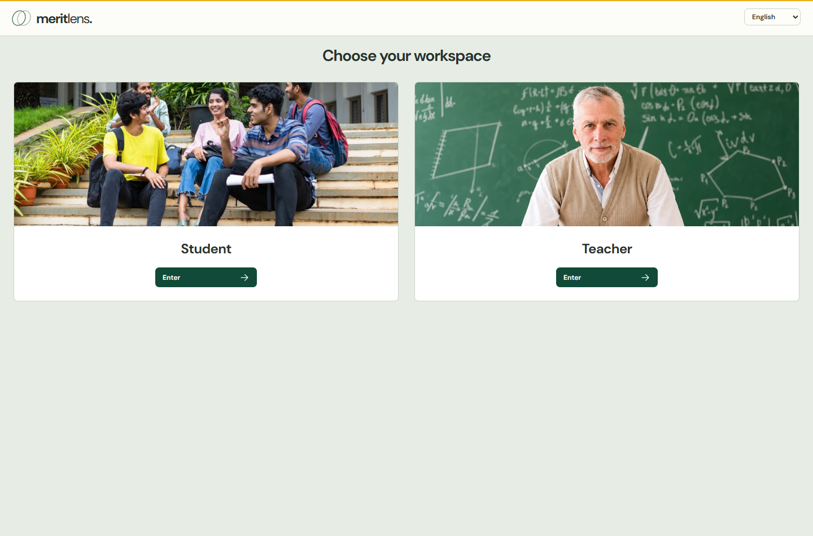

# Merit Lens

I made Merit Lens to help teachers check if students understand the work they submit.

Students upload their work and answer a short interview. Teachers can read the answers, check the suggested grade and download a PDF report.

[Try the demo](https://merit-lens-nine.vercel.app)

The public demo uses practice questions and sample grading. Live AI assessment needs your own OpenAI key. Voice uses ElevenLabs when configured.



## Features

- Upload work and grading criteria, including points already written in the assignment PDF.
- Answer by voice or text.
- Standard mode asks independent questions. Challenging mode checks whether the student can apply an idea to a new situation.
- Review answers and grades, then download the report.
- Use English or Hungarian.

The demo includes MATLAB, thesis and project description assignments.

## Run locally

You need Node.js 22.18 or newer.

```bash
npm ci
cp .env.example .env
npm run dev
```

On PowerShell, use `Copy-Item .env.example .env`. Open http://127.0.0.1:5175.

Add your own API keys to `.env` for live assessment and voice. Without an OpenAI key, the app uses practice rules. Restart after changing settings.

For a production build, run `npm run build` followed by `npm start`.

## Development

The app uses React and Vite, with an Express API and SQLite. Vercel hosting uses Turso for saved data. Camera checks run locally in the browser.

- `src`: pages and browser features
- `server`: API, interviews and reports
- `shared`: rules used by the browser and server
- `public`: images, fonts and camera models
- `tests`: backend and browser checks
- `scripts`: setup and maintenance tools

Run `npm test` and `npm run build` to check changes. Browser checks use `npm run test:ui`, installed Chrome and an in-memory database.

[Hosting setup](docs/DEPLOYMENT.md) · [Interview modes](docs/TRANSFER_CHALLENGE.md)

Suggested grades need teacher review. Camera warnings do not prove cheating.
